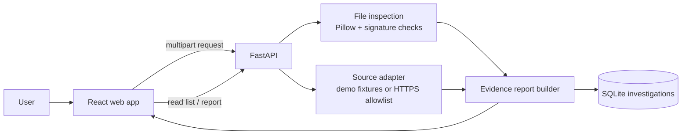

# Evidence Desk

Evidence Desk is a small, evidence-first misinformation investigation prototype. It helps a user inspect a supplied image or PDF, compare a claim against supplied sources, and save a report that links each finding to its evidence. It never treats missing metadata as proof of manipulation; unavailable or mixed evidence yields **Inconclusive**.

## Run locally

Prerequisites: Node.js 20+ and Python 3.10+.

```powershell
# Terminal 1: API
py -m venv .venv
.\.venv\Scripts\Activate.ps1
pip install -r requirements.txt
uvicorn backend.main:app --reload --port 8000

# Terminal 2: web app
npm install
npm run dev
```

Open <http://localhost:5173>. The UI proxies `/api` requests to the API at `http://127.0.0.1:8000`.

## Deploy to Render

The repository includes a multi-stage `Dockerfile` and a Render Blueprint in `render.yaml`. The Blueprint deploys the React build and FastAPI API as one web service, listens on Render's `PORT`, checks `/api/health`, and stores SQLite data and uploads under a 1 GB persistent disk mounted at `/var/data`.

Push this project to a Git repository, then create a **New Blueprint Instance** in the Render Dashboard and connect that repository. Render's persistent disks require a paid web-service plan; the included Blueprint selects the Starter plan and provisions a 1 GB disk. Review Render's current pricing and the Blueprint resources before creating the service. A persistent disk also limits deployment behavior (including zero-downtime deploys) and keeps local files on one service instance. See [Render's persistent disk docs](https://render.com/docs/disks) and [Blueprint reference](https://render.com/docs/blueprint-spec).

The current workspace has no Git remote, so it must be pushed to a repository before Render can build this Blueprint. No secrets are needed for the demo.

To enable live source fetching, set `OFFICIAL_SOURCE_DOMAINS` to a comma-separated list of trusted hostnames before starting the API (for example, `university.edu,registrar.university.edu`). Only HTTPS pages on those hosts are fetched. This is a prototype allowlist, not a general search engine. The two `demo.university.edu` URLs are synthetic fixtures and are never fetched over the network.

Investigation records live in `data/investigations.sqlite3`; uploaded files live in `uploads/`. Both are local and ignored by Git. Uploads are limited to 10 MB and PNG, JPG, WEBP, or PDF. The API returns clear errors for unsupported or unreadable files.

## Demo script

1. Start the API and frontend, then click **New investigation**.
2. Click **Exam cancellation notice** under “Try the demo.” Add an optional image and investigate. The result is Supported by a clearly labeled synthetic source.
3. Repeat with **Exams continue notice**. The same claim is Contradicted by a distinct synthetic source.
4. Create a claim without a source. The result is Inconclusive.
5. Open any saved report from Recent investigations to show its evidence, file details, methods, limitations, and persistence.

These demo records are fictional. Do not present them as real university announcements.

## Verification and limitations

- Source comparison is lightweight keyword and polarity matching. It is a screening aid, not a fact-checker; each report includes the source excerpt and asks for human review.
- A source must be supplied by the user. Live fetching is restricted to the configured official-domain allowlist; no broad web search is performed. Retrieval failures are recorded as unavailable and cannot support or contradict a claim.
- Image inspection reports format, byte size, dimensions, and EXIF fields when present. Missing EXIF is explicitly “Not available.” No forensic manipulation or deepfake detector is implemented.
- PDF handling validates the file signature and records its type and size; PDF text, embedded objects, edit history, OCR, and metadata parsing are not implemented.
- Uploaded files are stored locally. The prototype does not implement user accounts, access control, malware scanning, or automatic deletion.
- The Render Blueprint uses a single service and persistent disk for this prototype. The disk adds paid usage; review the plan and disk in Render before creating the service.
- Overall Supported/Contradicted is assigned only when source evidence points one way. Mixed, unavailable, or insufficient source evidence stays Inconclusive.

## API

| Method | Route | Purpose |
| --- | --- | --- |
| `GET` | `/api/health` | API status and source mode |
| `GET` | `/api/demo-sources` | Labeled synthetic fixture sources |
| `GET` | `/api/investigations` | Saved dashboard records |
| `POST` | `/api/investigations` | Analyze a claim (`multipart/form-data`: `claim`, optional `message`, JSON `source_urls`, optional `file`) |
| `GET` | `/api/investigations/{id}` | Retrieve the complete report |

## Architecture



## Test cases

Run the backend suite with `python -m unittest backend.test_main -v` after installing requirements. It covers:

1. Synthetic official cancellation notice supports a cancellation claim and includes an excerpt.
2. Synthetic current notice that exams continue contradicts the same claim.
3. No source returns Inconclusive and persists the dashboard/report record.
4. Image without EXIF is reported as metadata unavailable, not manipulated.
5. Unsupported and corrupt images return clear client errors.
6. An unapproved source host returns unavailable evidence and an Inconclusive result.

The test suite uses a temporary SQLite database and upload folder.
